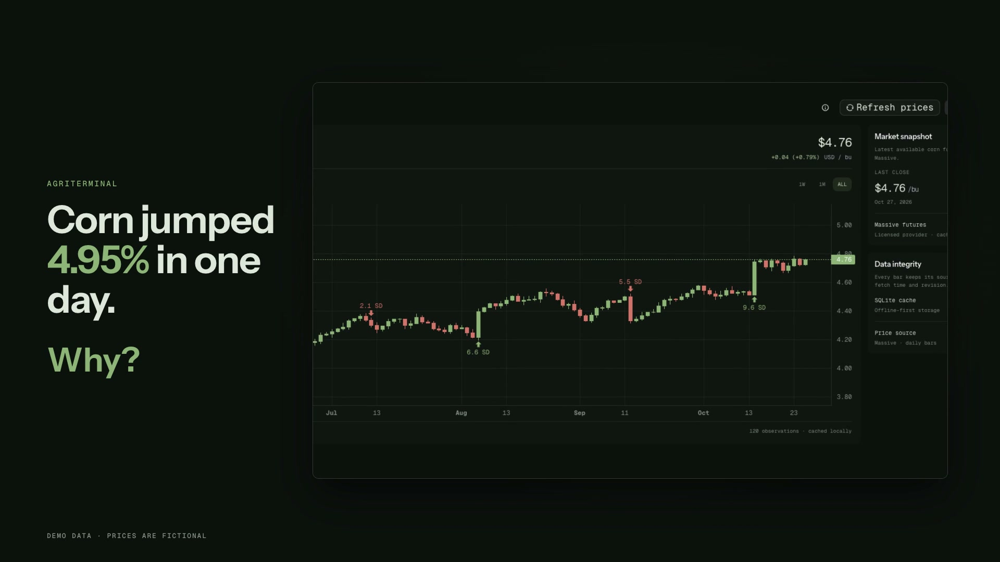

# AgriTerminal

AgriTerminal is an offline-first desktop workspace for agricultural commodity markets. The first vertical slice provides a local SQLite price store, a clearly labeled synthetic corn fallback, and an optional Massive daily-bar connector.

## See it working

[](docs/media/agriterminal-explainer.mp4)

A 23-second walkthrough of the real interface ([watch the video](docs/media/agriterminal-explainer.mp4)). For a longer, feature-by-feature tour with screenshots and notes on how each part works, open [`demo/explainer/index.html`](demo/explainer/index.html).

Every screenshot and frame is the unmodified React app running in a browser against a mocked Tauri bridge, so all prices, headlines and plugins in them are fictional demonstration data, not market quotes.

### Run the demo

```bash
npm install
npm run dev
```

Then open <http://localhost:1420/demo.html> (add `?onboarding=1` to see first-run setup). `demo/mock.ts` answers every `invoke` command from the fixtures in `demo/fixtures.ts` and emits the `data-updated` and `source-status` events on timers; `demo/entry.ts` installs the mock and then boots the normal `src/main.tsx`. Nothing under `src/` is changed for the demo. The weather map stays blank in the demo because it needs map tiles from the network.

Music in the video: "Happy Beats / Business Moves" (Vol. 1) by Sascha Ende, [ende.app](https://ende.app/en) (CC BY 4.0). Its sound effects are from [Kenney](https://kenney.nl/) (CC0).

## Development

Install dependencies with `npm install`, then start the desktop app with `npm run tauri dev`. The frontend uses React, TanStack Query, Lightweight Charts, and the existing shadcn components in `src/components/ui`. The Rust backend owns SQLite data in Tauri's application data directory.

The corn fixture lives in `tests/fixtures/corn_daily.csv`. It is synthetic demonstration data, not a market quote. AgriTerminal keeps it visibly labeled and uses it when no real market observations are cached.

## Price data

Futures prices come from [Massive](https://massive.com/pricing?product=futures) (formerly Polygon.io). Add a Massive API key from **Data sources**; the free Futures Basic plan is enough. The key is stored in the operating system keychain, sent only in the `Authorization` header, and never written to SQLite or logs.

Massive has no continuous contract, so **Load prices** requests 30 days of daily session bars for the two nearest corn, soybean and wheat contracts and keeps, for each session, the bar of whichever contract traded more. A session still in progress has no settlement price yet and is skipped until it settles. CBOT quotes grains in U.S. cents per bushel, so values are normalized to USD per bushel before storage and display. The free plan allows five requests a minute and a refresh makes seven, so a refresh waits for the limit to reset and takes about a minute. After a key is saved, a background refresh runs every 24 hours. Bars retain their source, release time, fetch time, unit, and revision. Bars stored by the earlier Databento connector are kept and still shown as market data.

## Current implementation

Backend (`src-tauri/src`)

- Versioned SQLite schema, as-of series queries, and revisions that never overwrite an observation.
- One `DataSource` trait with Massive (ZC, ZS, ZW daily front-month bars), CFTC Commitments of Traders, USDA NASS crop condition and progress, USDA FAS balance sheets and export sales, and U.S. Drought Monitor connectors. Weekly reports carry a scheduled `released_at` for backfilled history and the real fetch time for recent rows.
- A scheduler with per-source cadence, jittered exponential backoff, `Retry-After` handling and catch-up of missed runs at startup.
- Keychain storage for provider keys, connection tests, and a report calendar seeded from `config/report-calendar.json` (a copy in the app data directory overrides it).
- A declarative plugin system: TOML manifests run by one permission-enforcing HTTP client, a validating installer, and a Plugins panel that shows permissions before anything runs. The Drought Monitor connector is a bundled manifest (see `docs/plugins.md`).
- NWS and Open-Meteo weather and GDELT plus USDA RSS news, cached locally and refreshed in the background.
- Price alerts that fire once per crossing and re-arm when the price moves back, CSV and workspace export into the app data directory, and a settings table.
- `analytics`: an as-of join that cannot look ahead, seasonal ranges, move detection, scheduled-event and news attribution with confidence labels, a combined crop stress timeline, and a backtest harness (see `docs/backtest.md`).

Frontend (`src`)

- A dockview workspace with a command bar (`/`), link groups, saved workspaces (the menu beside the workspace name switches between them, saves the layout as a new one, or deletes one; `WS name` switches from the command bar), pop-out windows (`Alt+P`), and keyboard navigation (`Alt+Left/Right` to cycle panels, `Alt+W` to close).
- Panels: price chart with flagged-move markers, COT, crop condition, supply and demand, drought, weather, news, report calendar, crop stress timeline, move explainer, price alerts, raw data (`RAW`: every stored row by source, plus the weather and news caches, as a table or JSON), settings and export, and help (`HELP` or `?`: every command, what each panel shows and how to read it, status labels and a glossary of market terms; the ⓘ button on any panel shows its part of the guide in place). Panel settings forms are generated from each panel's JSON schema and preview live.
- Dark and light themes (or match the system), USD per bushel or per metric tonne display, and a release-alert lead time from 1 to 48 hours or off, all under `SETTINGS`. The terminal palette is paired dark and light tokens in `src/theme.css`; stored prices stay in USD per bushel.
- First-run onboarding (role, crops, home state, optional keys) that loads a Farmer, Trader, Analyst or Student template from `config/workspace-templates.json`; `TEMPLATE name` reloads one. Link-group crops persist between launches.

Not built yet: panel and analysis plugins, a plugin registry, the USDA AMS basis connector, the demand pulse and other combined views, and packaging. NASS and FAS parsers are tested against invented fixtures shaped from documentation because both need a key; verify them with a keyed response. See [the implementation plan](docs/AgriTerminal%20Implementation%20Plan.md) and [the product requirements](docs/prd.md).

## Checks

```bash
npm run lint && npm test && npm run build
cargo fmt --manifest-path src-tauri/Cargo.toml --check
cargo clippy --manifest-path src-tauri/Cargo.toml --all-targets -- -D warnings
cargo test --manifest-path src-tauri/Cargo.toml
cargo test --manifest-path src-tauri/Cargo.toml -- --ignored   # live provider contracts
```
