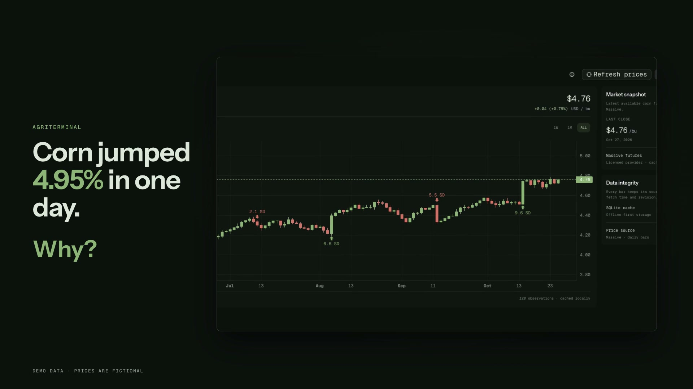

# AgriTerminal

AgriTerminal is an offline-first desktop workspace for agricultural commodity markets. The first vertical slice provides a local SQLite price store, a clearly labeled synthetic corn fallback, and an optional Massive daily-bar connector.

## See it working

[](docs/media/agriterminal-explainer.mp4)

A 23-second walkthrough of the real interface ([watch the video](docs/media/agriterminal-explainer.mp4)). For a longer, feature-by-feature tour with screenshots and notes on how each part works, open [`demo/explainer/index.html`](demo/explainer/index.html).

Every screenshot and frame is the unmodified React app running in a browser against a mocked Tauri bridge, so all prices, headlines and plugins in them are fictional demonstration data, not market quotes.

### Run the demo

```bash
npm install
npm run dev
```

Then open <http://localhost:1420/demo.html> (add `?onboarding=1` to see first-run setup). `demo/mock.ts` answers every `invoke` command from the fixtures in `demo/fixtures.ts` and emits the `data-updated` and `source-status` events on timers; `demo/entry.ts` installs the mock and then boots the normal `src/main.tsx`. Nothing under `src/` is changed for the demo. The weather map stays blank in the demo because it needs map tiles from the network.

Music in the video: "Happy Beats / Business Moves" (Vol. 1) by Sascha Ende, [ende.app](https://ende.app/en) (CC BY 4.0). Its sound effects are from [Kenney](https://kenney.nl/) (CC0).

## Development

Install dependencies with `npm install`, then start the desktop app with `npm run tauri dev`. The frontend uses React, TanStack Query, Lightweight Charts, and the existing shadcn components in `src/components/ui`. The Rust backend owns SQLite data in Tauri's application data directory.

The corn fixture lives in `tests/fixtures/corn_daily.csv`. It is synthetic demonstration data, not a market quote. AgriTerminal keeps it visibly labeled and uses it when no real market observations are cached.

## Price data

Futures prices come from [Massive](https://massive.com/pricing?product=futures) (formerly Polygon.io). Add a Massive API key under **Settings › Data sources**; the free Futures Basic plan is enough. The key is stored in the operating system keychain, sent only in the `Authorization` header, and never written to SQLite or logs.

Massive has no continuous contract, so a refresh requests 30 days of daily session bars for the two nearest corn, soybean and wheat contracts and keeps, for each session, the bar of whichever contract traded more. A session still in progress has no settlement price yet and is skipped until it settles. CBOT quotes grains in U.S. cents per bushel, so values are normalized to USD per bushel before storage and display. The free plan allows five requests a minute and a refresh makes seven, so a refresh waits for the limit to reset and takes about a minute. After a key is saved, a background refresh runs every 24 hours. Bars retain their source, release time, fetch time, unit, and revision. Bars stored by the earlier Databento connector are kept and still shown as market data.

## Current implementation

Backend (`src-tauri/src`)

- Versioned SQLite schema, as-of series queries, and revisions that never overwrite an observation.
- One `DataSource` trait with Massive (ZC, ZS, ZW daily front-month bars), CFTC Commitments of Traders, USDA NASS crop condition and progress, USDA FAS balance sheets and export sales, and U.S. Drought Monitor connectors. Weekly reports carry a scheduled `released_at` for backfilled history and the real fetch time for recent rows.
- A scheduler with per-source cadence, jittered exponential backoff, `Retry-After` handling and catch-up of missed runs at startup.
- Keychain storage for provider keys, connection tests, and a report calendar seeded from `config/report-calendar.json` (a copy in the app data directory overrides it).
- A declarative plugin system: TOML manifests run by one permission-enforcing HTTP client, a validating installer, and plugin sources listed with every other source in Settings, showing their permissions before anything runs. The Drought Monitor connector is a bundled manifest (see `docs/plugins.md`).
- NWS and Open-Meteo weather and GDELT plus USDA RSS news, cached locally and refreshed in the background.
- River data for the Mississippi at St. Louis and Memphis: daily stage (USGS, and NWS with an Iowa Environmental Mesonet backfill), NWS forecasts by issue time, and weekly USDA barge rates and lock tonnage dated to the Grain Transportation Report that published them. Gauges, thresholds and weights are in `config/waterways.json` (a copy in the app data directory overrides it).
- Price alerts that fire once per crossing and re-arm when the price moves back, built-in river alerts, CSV export into the app data directory, and a settings table.
- `analytics`: an as-of join that cannot look ahead, seasonal ranges, move detection, scheduled-event, news and river attribution with confidence labels, combined crop stress and river timelines, a river constraint score with freight sensitivity, and backtest harnesses for the move explainer and the river alerts (see `docs/backtest.md` and `docs/river.md`).

Frontend (`src`)

- One window with five fixed pages in a sidebar: Market, Crop & weather, Supply & demand, River and Alerts (keys `1` to `5`), then Settings and Help. One crop switcher (Corn, Soybeans, Wheat) in the top bar that every page follows, and a Go to… command bar (`/`). The app reopens on the last page and crop; there is no layout to arrange.
- Sections: price chart with flagged-move markers, move explainer, report calendar and news (Market); crop stress timeline, crop condition, drought with an inline state picker, and weather (Crop & weather); supply and demand and COT (Supply & demand); river status and river timeline with an inline gauge picker (River); price and river alerts with report reminders (Alerts); and help (`HELP` or `?`: every command, what each section shows and how to read it, status labels and a glossary of market terms; the ⓘ button beside any section heading shows its part of the guide in place).
- One Settings page (in the sidebar, or `SETTINGS`): dark and light themes (or match the system) and USD per bushel or per metric tonne display; every data source with its status, key and refresh, pause and test actions, plugins among them; and the data folder, CSV export, and a viewer for every stored row by source, plus the weather and news caches, as a table or JSON. The report reminder lead time, from 1 to 48 hours or off, is on the Alerts page. The terminal palette is paired dark and light tokens in `src/theme.css`; stored prices stay in USD per bushel.
- First-run setup: crops, home state and optional keys. The first crop chosen is the one the app opens on, and the home state is the Drought Monitor's starting state.

Not built yet: panel and analysis plugins, a plugin registry, the USDA AMS basis connector (so the river timeline has no Gulf–interior basis spread yet), the demand pulse and other combined views, code-signed installers and in-app updates. NASS and FAS parsers are tested against invented fixtures shaped from documentation because both need a key; verify them with a keyed response. See [the implementation plan](docs/AgriTerminal%20Implementation%20Plan.md), [the product requirements](docs/prd.md) and, for the river constraint index, [its method and calibration](docs/river.md).

## Checks

```bash
npm run lint && npm test && npm run build
cargo fmt --manifest-path src-tauri/Cargo.toml --check
cargo clippy --manifest-path src-tauri/Cargo.toml --all-targets -- -D warnings
cargo test --manifest-path src-tauri/Cargo.toml
cargo test --manifest-path src-tauri/Cargo.toml -- --ignored   # live provider contracts
```

## Releases

Every push to `master` that changes more than documentation runs the checks above, then builds installers and publishes them as a GitHub release: a universal `.dmg` for macOS, an `.msi` and a setup `.exe` for Windows, and a `.deb`, `.rpm` and `.AppImage` for Linux. To release a commit that a documentation-only push skipped, run the Release workflow from the Actions tab.

The release version starts from `version` in `src-tauri/tauri.conf.json`. Its first release is tagged with that version as it is (`v0.1.0`), and each later release counts up the patch number (`v0.1.1`, `v0.1.2`, …). To start a new series, set a new version there, such as `0.2.0`. The version in the repository is not changed; each build stamps its own.

The macOS app has only an ad-hoc signature and the Windows installers are unsigned. On first launch, macOS asks you to allow AgriTerminal under System Settings › Privacy & Security, and Windows SmartScreen warns before it installs.

## License

MIT. See [LICENSE](LICENSE).
